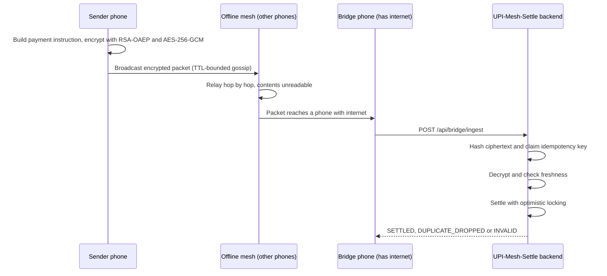

# UPI-Mesh-Settle

[](https://github.com/Hariom-55/UPI-Mesh-Settle/actions/workflows/ci.yml)


[](LICENSE)

**Offline UPI payments, settled safely.** A Spring Boot backend that simulates a payment travelling through a mesh of offline phones and reaching a bank only when some device finally gets internet. The hard part is not the mesh. It is settling a payment correctly when it arrives **late, out of order, and possibly more than once**.

**Live demo:** https://upi-mesh-settle.onrender.com
*(Free-tier hosting sleeps when idle, so the first load after a quiet period can take up to ~2 minutes to wake.)*

*Not affiliated with or endorsed by NPCI. "UPI" is used descriptively for a personal demo project.*

## The problem

UPI needs live connectivity at the moment of payment. In basements, rural areas and crowded venues it often isn't there, yet two phones standing next to each other could exchange a payment instruction locally. Getting that instruction to a backend later raises problems that have nothing to do with Bluetooth:

- **Confidentiality.** Strangers' phones relay the packet. They must not be able to read it.
- **Duplicate delivery is the default.** Several devices can upload the same packet. It must settle **exactly once**.
- **Concurrency.** Parallel duplicates must not both pass a balance check and both debit.
- **Staleness.** A packet signed days ago must not settle as if it were fresh.

These are the same settlement-correctness problems a payment switch faces under retries and network partitions. Full write-up: [docs/01-problem-statement.md](docs/01-problem-statement.md).

## How it works



## Key design decisions

| Decision | Why |
|---|---|
| **Hybrid RSA-2048 (OAEP) + AES-256-GCM** | AES encrypts the payload, RSA wraps a one-time AES key for the server. Relays can't read it, and GCM makes tampering detectable. |
| **Idempotency key = SHA-256 of the ciphertext** | Derived from the actual bytes, so a relay can't dodge deduplication by changing packet metadata. |
| **Atomic claim via `ConcurrentHashMap.putIfAbsent`** | Two threads racing for the same packet cannot both win. |
| **Freshness window on `signedAt` (default 24 h)** | The timestamp sits inside the encrypted, authenticated payload, so the mesh can't forge it. Stale and far-future packets are rejected. |
| **JPA optimistic locking (`@Version`) on `Account`** | A stale read can't silently overwrite a concurrent balance update. The loser fails loudly and retries. |
| **Rejected payments are recorded, not dropped** | An insufficient-balance attempt gets a `REJECTED` transaction row, so the audit trail is complete. |
| **Global exception handler** | Every error returns one JSON shape. Internal messages and stack traces never reach the client. |

Details and trade-offs: [docs/02-proposed-solution.md](docs/02-proposed-solution.md).

## Quick start

### Try it live
Open https://upi-mesh-settle.onrender.com, press **Auto-run**, then press the upload step a second time. The first upload settles. The second reports `DUPLICATE_DROPPED`.

### Run locally
Requires JDK 21+.

```bash
cd Application
./mvnw spring-boot:run        # Windows PowerShell: .\mvnw spring-boot:run
```

Open http://localhost:8080/ for the dashboard. Four demo accounts are seeded on every start:

| VPA | Holder | Balance (₹) |
|---|---|---|
| alice@demo | Alice | 5000 |
| bob@demo | Bob | 1000 |
| carol@demo | Carol | 2500 |
| dave@demo | Dave | 500 |

### Run with Docker
```bash
docker build -f infra/Dockerfile -t upi-mesh-settle .
docker run --rm -p 8080:8080 upi-mesh-settle
```

### Run the tests
```bash
cd Application
./mvnw test
```

## API overview

| Method | Path | Purpose |
|---|---|---|
| GET | `/api/server-key` | Server's RSA public key |
| POST | `/api/demo/send` | Build, encrypt and inject a payment into the mesh |
| POST | `/api/mesh/gossip` | Advance the simulated mesh by one round |
| GET | `/api/mesh/state` | Packets held by each simulated device |
| POST | `/api/mesh/flush` | Internet-connected devices upload to the backend |
| POST | `/api/mesh/reset` | Clear the mesh and the idempotency cache |
| POST | `/api/bridge/ingest` | Settlement entry point a real bridge device would call |
| GET | `/api/accounts` | Accounts and balances |
| GET | `/api/transactions` | Latest 20 transactions |

Request and response shapes: [docs/03-api-reference.md](docs/03-api-reference.md).

## Testing and performance

**8 automated tests**, run on every push by GitHub Actions. They cover:

- exactly-once settlement when **50 simultaneous bridge nodes** deliver the same packet
- encryption round trip and tamper detection
- insufficient-balance rejection and stale-packet (replay) rejection
- error responses for unknown devices and invalid request bodies

**Load test** ([`perf/load-test.js`](perf/load-test.js), [k6](https://k6.io)), run locally against in-memory H2 with one sequential client:

| Scenario | Result |
|---|---|
| 200 end-to-end settlements (encrypt, decrypt, dedupe, freshness, balance update) | 0 failures, p95 request latency 27.7 ms |
| 20 concurrent users reading `/api/accounts` for 30 s | 0% errors, p95 latency 9.2 ms |

Account balances were checked after the run: exactly 200 payments applied. These figures describe a local, single-client run and are not a capacity claim. Reproduce with `k6 run perf/load-test.js`.

## Tech stack

Java 21 · Spring Boot 4 (Web MVC, Data JPA, Validation) · H2 · Lombok · Maven · JUnit 5 and MockMvc · k6 · Docker · GitHub Actions · Render

## Configuration

| Setting | Default | Purpose |
|---|---|---|
| `PORT` | `8080` | HTTP port (hosting platforms inject this) |
| `H2_CONSOLE_ENABLED` | `true` locally, `false` in the container | Toggle the unauthenticated H2 web console |
| `upi.mesh.idempotency-ttl-seconds` | `86400` | How long a packet hash is remembered |
| `upi.mesh.packet-max-age-seconds` | `86400` | Packets older than this are rejected as replays |

## Project structure

```
UPI-Mesh-Settle/
├── Application/          Spring Boot source (pom.xml, src/, static dashboard)
├── docs/                 Problem statement, design rationale, API reference
├── infra/                Dockerfile
├── perf/                 k6 load test
└── .github/workflows/    CI pipeline
```

## Limitations and roadmap

Deliberate scope cuts for a demonstrable backend:

- **The mesh is simulated.** There is no real Bluetooth. Gossip currently floods every simulated device in one round, with no neighbour topology yet.
- **Single node.** The idempotency cache lives in memory, so "exactly once" holds for one backend instance. Scaling out would need a shared store, such as a database unique constraint or Redis.
- **No authentication.** VPAs are trusted as given, and `/api/bridge/ingest` is open. A real bridge device would have to authenticate.
- **Data is not persistent.** H2 is in-memory and resets on every restart.

Next: a neighbour-based mesh topology so TTL and hop counts matter, a persistent database with a unique-key idempotency store, and bridge-device authentication.

## Author

Hariom Tiwari · [GitHub](https://github.com/Hariom-55)

Released under the [MIT License](LICENSE).
